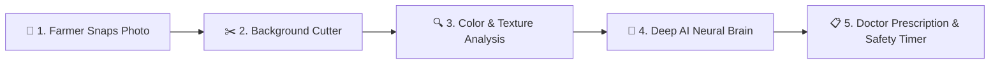

# 🍃 MORUS-LENS: Complete End-to-End System Guide
> **An Easy-to-Understand, Non-Technical Walkthrough of the AI Mulberry Crop Intelligence Platform**  
> **Created by:** Sathish Kumar · *Data Scientist & AI Researcher*  
> **Location:** Tirupattur, Tamil Nadu, India  
> **Contact:** sathishkumar.ds2027@gmail.com · WhatsApp: [+91 86105 25967](https://wa.me/918610525967) · [LinkedIn Profile](https://www.linkedin.com/in/sathish-kumar-datascientist/)

---

## 📑 Table of Contents
1. [Chapter 1: The Big Picture — What is MORUS-LENS?](#chapter-1-the-big-picture--what-is-morus-lens)
2. [Chapter 2: Why Did We Build This? (The Real-World Problem)](#chapter-2-why-did-we-build-this-the-real-world-problem)
3. [Chapter 3: How Does It Work? (A Simple Step-by-Step Analogy)](#chapter-3-how-does-it-work-a-simple-step-by-step-analogy)
4. [Chapter 4: The 4 Health Conditions Explained](#chapter-4-the-4-health-conditions-explained)
5. [Chapter 5: A Tour of Every Feature in the Website](#chapter-5-a-tour-of-every-feature-in-the-website)
6. [Chapter 6: The "Under the Hood" Technology (Made Simple)](#chapter-6-the-under-the-hood-technology-made-simple)
7. [Chapter 7: How to Run and Test the Application](#chapter-7-how-to-run-and-test-the-application)
8. [Chapter 8: Developer & Support Desk](#chapter-8-developer--support-desk)

---

## Chapter 1: The Big Picture — What is MORUS-LENS?

Imagine having an **expert plant pathologist and sericulture scientist sitting in your smartphone 24/7**.

Whenever you are standing in a mulberry field, you simply take a photo of a leaf. Within **one second**, **MORUS-LENS**:
1. Looks at the leaf using Artificial Intelligence (AI).
2. Tells you whether the leaf is **Healthy**, infected with **Leaf Rust**, or infected with **Leaf Spot**.
3. Gives you a precise percentage score (e.g., *"96.4% confident"*).
4. Provides a practical doctor’s prescription: what organic or chemical spray to use, how much to mix, and **exactly how many days you must wait** before feeding the leaf to your silkworms to prevent silkworm death.

That is **MORUS-LENS** — an intelligent, mobile-ready agricultural portal designed to protect mulberry crops and boost silk farmers' profits.

---

## Chapter 2: Why Did We Build This? (The Real-World Problem)

### What is Sericulture and Why is Mulberry Sacred?
- **Sericulture** is the farming of silk.
- Silkworms (*Bombyx mori*) are delicate creatures. They do **not eat anything else in the world except fresh, green Mulberry leaves** (*Morus alba* or *Morus indica*).
- If the mulberry leaves are sick, the silkworms stop eating, fall ill with digestive diseases (like *flacherie* or *grasserie*), or produce low-grade, fragile silk cocoons.

### The Big Challenges Farmers Face:
1. **Confusing Symptoms**: In early stages, Leaf Rust (orange-brown powdery bumps) and Leaf Spot (blackish sunken circles with yellow rings) look very similar to the untrained eye.
2. **Accidental Silkworm Poisoning**: If a farmer sprays a chemical pesticide or fungicide to cure a plant disease, that chemical remains toxic on the leaf for days. If a farmer feeds the leaf too soon, **the entire batch of silkworms can die in 24 hours**.
3. **No Access to Immediate Lab Tests**: Agricultural laboratories are miles away in universities or government offices. By the time an extension officer visits, the fungus has already spread through the whole plantation.

**MORUS-LENS solves all three problems instantly.**

---

## Chapter 3: How Does It Work? (A Simple Step-by-Step Analogy)

Think of MORUS-LENS like a doctor examining a patient:



### Step 1: The Farmer Takes a Photo (The Eyes)
The farmer clicks a photo using their mobile phone or uploads an image on their laptop.

### Step 2: Isolating the Leaf Blade (The Focus)
When people take photos, there is often a white background, a wooden table, fingers holding the stem, or shadows.  
MORUS-LENS has an **Intelligent Leaf Blade Segmenter**. It uses mathematical color filters (Excess Green Index: $2G - R - B$) and edge contour physics to ignore the background, shadows, and tables, focusing 100% of its attention **strictly on the green leaf surface**.

### Step 3: Pathology Scan (The Stethoscope)
The system analyzes the pixels of the leaf:
- How much of the leaf is healthy emerald green?
- Are there rusty-orange pustules with elevated red-to-blue ratios?
- Are there dark necrotic centers with yellow halos?

### Step 4: The Deep AI Brain (The Specialist Doctor)
The image is passed through a **Deep Neural Network** (based on *EfficientNetB0* and convolutional vision networks). This neural network was trained on thousands of leaf images. It recognizes micro-textures that human eyes often overlook.

### Step 5: The Prescription & Feeding Timer (The Cure)
Instead of just giving a cold machine answer like *"Rust"*, MORUS-LENS immediately provides:
- **Severity Level**: Healthy (Green), Warning (Amber), Danger (Red), or Unknown (Purple).
- **Exact Fungicide Recipe**: e.g., *Mancozeb 0.2% (2 grams per liter of water)*.
- **Mandatory Silkworm Waiting Period**: A countdown clock stating e.g., *"Wait 10 to 14 days before feeding larvae!"*

---

## Chapter 4: The 4 Health Conditions Explained

| Condition | Common Name | What Does It Look Like? | Action Required | Safe to Feed Worms? |
| :--- | :--- | :--- | :--- | :---: |
| 🌿 **Disease Free** | Healthy Mulberry | Smooth, vibrant green blade with unbroken veins. No spots or dust. | Continue balanced watering and split NPK fertilizer. | **YES — Immediate feeding is safe.** |
| ⚠️ **Potential Leaf Rust** | Mulberry Rust (*Cerotelium fici*) | Tiny yellowish pinpoints turning into reddish-brown or rusty orange powdery mounds on the underside of the leaf. | Spray Mancozeb 0.2% or Copper Oxychloride 0.2%. | **NO — Quarantine crop. Observe 10–14 days withholding.** |
| 🚨 **Potential Leaf Spot** | Leaf Spot (*Pseudocercospora mori*) | Irregular dark brown/black spots that dry up and fall out leaving "shot-holes". Yellow halo around spots. | Spray Bavistin (Carbendazim 0.1%) or Chlorothalonil. Remove fallen leaves. | **NO — Quarantine crop. Observe 10–12 days withholding.** |
| ❓ **Unknown / Ambiguous** | Unidentified Foliar Anomaly | Extremely blurry picture, non-mulberry leaf, or rare disease (e.g. Powdery Mildew, Mosaic Virus). | Retake photo in natural daylight or consult agriculture officer. | **NO — Do not feed until confirmed.** |

> 🛡️ **The "Safety Net" Feature (Out-of-Distribution Filter)**:  
> Traditional AI systems will forcefully make a wild guess even if you show them a banana leaf or a table surface!  
> **MORUS-LENS is smarter**: If the system detects that an image is low confidence (< 70%) or the symptoms don't clearly match, it honestly tags it as **"Unknown / Unidentified Disease"** so the farmer doesn't apply the wrong poison to their crop.

---

## Chapter 5: A Tour of Every Feature in the Website

### 1. 🔐 Private Farmer Accounts (No Demo Accounts)
- Every grower or student creates their own private account with a username and secure password.
- All your diagnostic history and farm photos belong exclusively to you and are stored securely in the database.

### 2. 📱 Fully Dynamic & Mobile Responsive
- **Built for Field Use**: Works seamlessly on iPhone, Android phones, tablets, and computers.
- **Touch-Friendly Hamburger Menu**: Click the three-line menu on mobile to smoothly open navigation.
- **Direct Camera Shutter**: Tapping the upload area on a mobile phone immediately activates the rear camera so you can snap leaf pictures directly on the tree.

### 3. 📊 Real-Time Diagnostic Dashboard (`/`)
- **Drag-and-Drop Area**: Drop images or pick from your phone gallery.
- **Live Preview**: See your uploaded leaf before running analysis.
- **Confidence Breakdown**: Interactive animated progress bars show the system's exact probability calculation for all 4 categories.
- **Printable Report**: One click lets you print or save the diagnosis as a PDF record for field inspections.

### 4. 🗂️ Farm Medical History Diary (`/history`)
- Every diagnosis you run is automatically saved in your personal history table.
- **Filter Tabs**: View *All Scans*, *Healthy*, *Leaf Rust*, *Leaf Spot*, or *Unknown*.
- **Inspection Modal**: Click "View Report" to inspect high-resolution leaf photos, the exact timestamp, and the agronomic treatment recommendations.
- **Privacy Control**: You can delete individual records or clear your log anytime.

### 5. 📖 Organic Botanical Field Handbook (`/guide`)
- Replaces artificial machine diagrams with an **organic, natural moriculture field reference**:
  - **4-Step Quick Diagnostic Key**: Visual flowchart walking you through inspecting the lower leaf blade under sunlight.
  - **Herbarium Specimen Profiles**: Scientific dossiers on *Morus alba L.*, leaf protein levels (22–25%), moisture content (70–75%), and fungal life cycles.
  - **Integrated Pest Management (IPM)**: Biological bio-controls (like *Trichoderma viride*) vs chemical interventions.
  - **Silkworm Safe Feeding Calendar**: Clear withholding tables to protect *Bombyx mori* silk larvae.

### 6. 📬 Developer & Reach-Out Help Desk (`/contact`)
- A dedicated bridge between farmers/researchers and the system creator, **Sathish Kumar**.
- Includes:
  - Direct 1-tap **WhatsApp Connection** (+91 86105 25967).
  - Direct **Email Button** (`sathishkumar.ds2027@gmail.com`).
  - **LinkedIn Profile** link for academic & data science networking.
  - **Inquiry Ticket Form**: Submit questions or request field advice. Messages are saved securely in the SQLite database and reviewed by Sathish Kumar.

---

## Chapter 6: The "Under the Hood" Technology (Made Simple)

For those who want to understand the building blocks without getting lost in technical jargon:

| Component | What Is It? | Why Did We Use It? |
| :--- | :--- | :--- |
| **Python** | The Programming Language | The gold standard for Data Science and Artificial Intelligence. |
| **Flask** | The Web Server Framework | Ultra-fast, lightweight, and reliable web engine that connects the user's browser with the AI brain. |
| **Flask-Login & PBKDF2** | The Security Guard | Hashes passwords so nobody (not even server admins) can read your private password. |
| **SQLite (`mulberry_app.db`)** | The Digital Filing Cabinet | A self-contained database that securely stores users, scan histories, and contact inquiries. |
| **OpenCV (`cv2`)** | Computer Vision Eyes | Performs color space conversions (RGB, HSV), morphological hull extraction, and isolates the leaf blade. |
| **Excess Green Index ($2G-R-B$)** | Botanical Physics Formula | Distinguishes living photosynthetic plant chlorophyll from white backgrounds, shadows, and hands. |
| **EfficientNetB0 / CNN** | Deep Learning Neural Network | A cutting-edge image recognition brain trained with transfer learning, heavy image rotations, zooms, and class-weight balancing. |

---

## Chapter 7: How to Run and Test the Application

### 1. Requirements
- A computer with Python (3.10, 3.11, or 3.14).
- Web browser (Chrome, Edge, Safari, Firefox).

### 2. Starting the Application
Open a terminal in the project directory and run:
```bash
python app.py
```
You will see:
```text
[OK] Loaded Botanical Vision Engine & Model
 * Running on http://127.0.0.1:5000
```

### 3. Using the Web Portal
1. Open your browser and go to: **`http://127.0.0.1:5000`**
2. Click **Create New Account** to register your username, email, and password.
3. On the **Crop Health Monitor** dashboard, upload any mulberry leaf photo (or snap a photo if on your phone).
4. Click **Run Diagnostic Scan**.
5. Read your instant disease classification, confidence score, and sericulture safety guide!

---

## Chapter 8: Developer & Support Desk

MORUS-LENS is actively researched and developed by:

- **Author**: **Sathish Kumar**
- **Role**: Data Scientist & AI Researcher
- **Location**: Tirupattur, Tamil Nadu, India
- **Email**: [sathishkumar.ds2027@gmail.com](mailto:sathishkumar.ds2027@gmail.com)
- **WhatsApp**: [+91 86105 25967](https://wa.me/918610525967?text=Hello%20Sathish,%20I%20have%20an%20inquiry%20regarding%20MORUS-LENS%20Mulberry%20Disease%20Prediction)
- **LinkedIn**: [Sathish Kumar | LinkedIn](https://www.linkedin.com/in/sathish-kumar-datascientist/)
- **GitHub Repository**: [Mulberry-Leaf-Disease-Prediction](https://github.com/sathishkumar1612/Mulberry-Leaf-Disease-Prediction)

*Empowering Sericulture Farmers with Lab-Grade Artificial Intelligence · MORUS-LENS*
