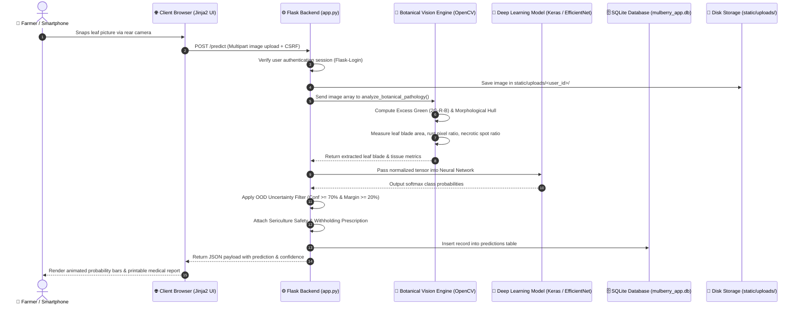

# 🌿 MORUS-LENS: Comprehensive End-to-End Project Report & System Architecture
**An In-Depth Technical & Non-Technical Reference for the AI-Powered Mulberry Leaf Pathology & Sericulture Intelligence System**

---

### 📋 Document Metadata
- **Project Title:** MORUS-LENS (Mulberry Leaf Disease Intelligence & Agronomic Portal)
- **Author & Lead Developer:** **Sathish Kumar** (Data Scientist & AI Researcher)
- **Location:** Tirupattur, Tamil Nadu, India
- **Contact:** [sathishkumar.ds2027@gmail.com](mailto:sathishkumar.ds2027@gmail.com) · **WhatsApp:** [+91 86105 25967](https://wa.me/918610525967)
- **LinkedIn:** [Sathish Kumar | Data Scientist](https://www.linkedin.com/in/sathish-kumar-datascientist/)
- **Repository:** [github.com/sathishkumar1612/Mulberry-Leaf-Disease-Prediction](https://github.com/sathishkumar1612/Mulberry-Leaf-Disease-Prediction)
- **Version:** 2.0 (Production Release)

---

## 📑 Table of Contents
1. [Executive Summary & Abstract](#1-executive-summary--abstract)
2. [Background & The Real-World Agricultural Problem](#2-background--the-real-world-agricultural-problem)
3. [Core Project Objectives & Capabilities](#3-core-project-objectives--capabilities)
4. [Exhaustive Folder & File Directory Breakdown](#4-exhaustive-folder--file-directory-breakdown)
5. [End-to-End Architecture & Request Lifecycle](#5-end-to-end-architecture--request-lifecycle)
6. [How the AI Works (Explained for Non-Technical Readers)](#6-how-the-ai-works-explained-for-non-technical-readers)
7. [The 4 Pathological Health Classes & Clinical Prescriptions](#7-the-4-pathological-health-classes--clinical-prescriptions)
8. [The Silkworm Safety & Chemical Withholding Calendar](#8-the-silkworm-safety--chemical-withholding-calendar)
9. [User Experience & Screen-by-Screen Walkthrough](#9-user-experience--screen-by-screen-walkthrough)
10. [Recent System Upgrades & Innovations](#10-recent-system-upgrades--innovations)
11. [How to Deploy, Run, and Test the Project](#11-how-to-deploy-run-and-test-the-project)
12. [Future Roadmap & Research Directions](#12-future-roadmap--research-directions)

---

## 1. Executive Summary & Abstract

### What is MORUS-LENS?
**MORUS-LENS** is an integrated Computer Vision and Web-based Crop Intelligence System specifically engineered for sericulture (silk farming) cultivators, moriculture agronomists, and agricultural researchers. 

The application enables a farmer or researcher to snap a photo of a mulberry leaf (*Morus alba* or *Morus indica*) using any smartphone camera or computer. Within **under one second**, the system:
1. Automatically detects and isolates the leaf from noisy backgrounds (such as tables, shadows, or holding fingers).
2. Classifies the leaf into one of four clinical categories: **Disease Free**, **Potential Leaf Rust**, **Potential Leaf Spot**, or **Unknown / Unidentified Foliar Anomaly**.
3. Calculates an exact mathematical confidence score (e.g. *98.2%*).
4. Generates an agronomic management action plan detailing exact organic treatments, fungicide dosages, and a **mandatory silkworm feed-withholding calendar** to prevent silkworm mortality.

### The Plain-English Explanation (For Non-Technical Readers)
Imagine standing in your farm field with thousands of mulberry trees. You notice strange brown spots spreading across the lower leaves. You do not know if it is harmless dirt, fungal rust, or a destructive leaf spot. Calling an agricultural officer from the university could take 4 to 5 days, during which your crop might be ruined. 

**MORUS-LENS is like having a university plant pathologist and sericulture doctor living inside your phone.** You take a picture, tap "Scan", and within a second it tells you what the disease is, what medicine to spray, how much water to dilute it with, and how many days you must wait before letting your silkworms eat the treated leaves.

---

## 2. Background & The Real-World Agricultural Problem

### 2.1 What is Sericulture and Why is Mulberry Sacred?
Sericulture is the agro-industry that produces natural silk. It supports millions of rural households across India (notably Tamil Nadu, Karnataka, and Andhra Pradesh) and Asia. 

The engine of this industry is the domestic silkworm, *Bombyx mori*. Silkworms are **strictly monophagous**—they feed **exclusively** on fresh, nutritious leaves of the mulberry tree (*Morus alba / Morus indica*). They consume no other food source.

The chemical and moisture quality of the mulberry leaf directly governs:
- Larval growth rate and resistance to diseases like *flacherie* and *grasserie*.
- Silkgland development inside the larva.
- Cocoon shell weight, filament length, and tensile silk grade.

### 2.2 The Disease Menace
Mulberry gardens are constantly attacked by foliar fungal pathogens:
1. **Mulberry Leaf Rust (*Cerotelium fici*)**: Erupts into thousands of brownish-orange powdery mounds (uredinia) on the underside of the leaf blade. It causes premature leaf yellowing, dehydration, and rapid leaf drop.
2. **Mulberry Leaf Spot (*Pseudocercospora mori*)**: Produces dark brown necrotic lesions surrounded by yellow chlorotic halos that dry up and fall out, creating "shot-holes". It reduces leaf protein content by up to 40%.

### 2.3 The "Pesticide Paradox" (The Real Hazard)
When farmers detect a fungal infection, they often rush to spray chemical fungicides (like Mancozeb, Carbendazim, or Copper Oxychloride). 

However, fungicides leave chemical residues on the leaf blade. If a farmer picks these treated leaves and feeds them to *Bombyx mori* larvae too early, **the silkworms suffer acute chemical toxicity, vomit digestive fluids, and die en masse within 24 to 48 hours**. 

Therefore, any diagnostic system **must not only detect the disease**, but must also clearly calculate and enforce the **safe withholding period** (typically 10 to 14 days) before leaves can be fed to larvae. **MORUS-LENS was built with this safety guarantee at its core.**

---

## 3. Core Project Objectives & Capabilities

- **Instant High-Accuracy Diagnosis**: Combine edge-aware color space processing with deep convolutional neural networks to classify leaf diseases in $< 1\text{ second}$.
- **Elimination of False Softmax Confidences**: Traditional neural networks blindly guess 99% confidence even when fed random photos of bananas, coins, or walls. MORUS-LENS integrates an **Out-of-Distribution (OOD) uncertainty filter** to route abnormal or ambiguous images to a dedicated *"Unknown / Ambiguous"* state.
- **Privacy & Multi-User Architecture**: Secure account registration and session management (`Flask-Login` + `Werkzeug PBKDF2`), allowing each farm to keep their own private diagnostic archive.
- **Mobile-Responsive Field Usability**: Adaptive mobile navigation drawer, fluid touch targets, and native smartphone camera shutter integration (`capture="environment"`).
- **Organic Botanical Reference**: A field handbook providing an in-field dichotomous key flowchart, herbarium specimen dossiers, and nutritional metrics.
- **Direct Reach-Out Channel**: A contact portal connecting farmers and researchers directly to author **Sathish Kumar** via 1-tap WhatsApp, email, and SQLite-backed inquiry ticketing.

---

## 4. Exhaustive Folder & File Directory Breakdown

Below is the directory map of the entire project repository, followed by an explanation of **why each file exists, what it does, and how it fits into the whole system**:

```text
f:\Mulberry-Leaf-Disease-Prediction\
├── app.py                                   # Master Flask Backend Application
├── streamlit_app.py                         # Alternative Interactive Streamlit Prototype
├── train_advanced_model.py                  # Two-Phase EfficientNetB0 Training Pipeline
├── mulberry_leaf_disease_Identification.keras # Pre-Trained Deep Learning Neural Network
├── requirements.txt                         # Python Dependency Specification
├── README.md                                # GitHub Repository Presentation & Documentation
├── INTEGRATION_GUIDE.md                     # Engineering & Production Deployment Guide
├── MORUS_LENS_COMPLETE_GUIDE.md             # End-to-End Plain-English System Handbook
├── MORUS_LENS_PROJECT_REPORT.md             # Master Technical & Non-Technical Report (This File)
├── .gitignore                               # Git Exclusion Rules
├── instance/
│   └── mulberry_app.db                      # SQLite Relational Database
├── static/
│   ├── css/
│   │   └── style.css                        # Agronomic Design System & Responsive Stylesheet
│   ├── js/                                  # Client-Side JavaScript Directory
│   └── uploads/                             # Per-User Archival Leaf Image Storage
│       └── <user_id>/                       # Isolated Directory for Each Farmer's Uploads
└── templates/
    ├── base.html                            # Master Base Template with Responsive Navigation
    ├── dashboard.html                       # Main Leaf Scanner & Live Diagnostic Report
    ├── history.html                         # Filterable Diagnostic History & Report Modal
    ├── guide.html                           # Organic Moriculture Herbarium & Field Handbook
    ├── contact.html                         # Developer Sathish Kumar Card & Inquiry Form
    ├── login.html                           # Secure Sign-In Portal
    ├── register.html                        # New User Account Creation Portal
    └── index.html                           # Alternate Welcome Landing Screen
```

---

### Detailed Purpose of Every File & Directory

#### 1. Root Application Files

- **`app.py` (The Heart and Brain of MORUS-LENS)**
  - *Why it is here:* This is the central server script that coordinates the entire platform.
  - *What it does:*
    1. **Web Server Routes**: Handles URL requests (`/`, `/login`, `/register`, `/history`, `/guide`, `/contact`, `/predict`).
    2. **Database Models**: Defines the SQLite tables: `User` (login accounts), `Prediction` (scan history), and `ContactMessage` (inquiries sent to Sathish Kumar).
    3. **Session Security**: Uses `Flask-Login` and `Werkzeug` PBKDF2 password hashing to guard user sessions.
    4. **Botanical Vision Engine (`analyze_botanical_pathology`)**: Analyzes the raw leaf image using OpenCV, separates leaf tissue from tables/backgrounds using the Excess Green Index ($2G - R - B$), and measures healthy green vs rust vs dark spot ratios.
    5. **Inference Pipeline (`perform_leaf_inference`)**: Combines OpenCV botanical segmentation with Keras/TensorFlow deep neural networks to produce the final classification and confidence percentage.
    6. **Prescription Engine (`get_disease_recommendations`)**: Translates classification codes into actionable farmer instructions (dosages, silkworm waiting days, and bio-controls).

- **`streamlit_app.py` (The Fast Data Science Playground)**
  - *Why it is here:* Serves as a standalone, zero-setup interactive demonstration interface.
  - *What it does:* Uses the Streamlit framework to let researchers rapidly test the model without running the full database/authentication web application. It imports and shares the exact same `perform_leaf_inference` engine from `app.py`.

- **`train_advanced_model.py` (The Model Laboratory)**
  - *Why it is here:* Allows developers and researchers to retrain or fine-tune the deep learning model whenever new mulberry leaf datasets are gathered.
  - *What it does:*
    1. Implements an **EfficientNetB0** transfer learning architecture pre-trained on ImageNet.
    2. Applies heavy agricultural data augmentations (random rotations, zooms, horizontal/vertical flips, and contrast changes) to simulate harsh field lighting.
    3. Uses **Two-Phase Transfer Learning**: Phase 1 freezes the backbone to train classification heads; Phase 2 unfreezes top convolutional layers with a tiny learning rate ($10^{-5}$) for subtle fine-tuning.
    4. Automatically balances uneven datasets using Scikit-Learn class weights.

- **`mulberry_leaf_disease_Identification.keras` (The Trained AI Brain)**
  - *Why it is here:* This 39.7 MB binary file stores the pre-calculated mathematical weights (parameters) of the deep neural network.
  - *What it does:* When a leaf image is preprocessed into numbers, it passes through millions of matrix multiplications defined by this file to output probability scores for Healthy, Rust, and Spot.

- **`requirements.txt` (The Project Recipe Book)**
  - *Why it is here:* Lists every third-party Python library needed to execute the application.
  - *What it contains:* `Flask`, `Flask-Login`, `Flask-SQLAlchemy`, `Werkzeug`, `Pillow`, `numpy`, `opencv-python-headless`, and `streamlit`.

- **`README.md` & `INTEGRATION_GUIDE.md`**
  - *Why they are here:* Standard project presentation files for GitHub visitors and DevOps engineers detailing how to clone, install, and deploy MORUS-LENS using WSGI servers like Gunicorn or Waitress.

- **`MORUS_LENS_COMPLETE_GUIDE.md`**
  - *Why it is here:* A user-facing, non-technical handbook explaining the project using analogies for non-technical users.

- **`MORUS_LENS_PROJECT_REPORT.md` (This File)**
  - *Why it is here:* The definitive master technical and functional reference document for project viva, examinations, and architectural documentation.

- **`.gitignore`**
  - *Why it is here:* Tells Git to ignore temporary files, Python compiled bytecode (`__pycache__`), virtual environment folders (`myenv/`), and private SQLite database instances so they are not committed to public version control.

---

#### 2. The `instance/` Directory

- **`instance/mulberry_app.db` (The Digital Filing Cabinet)**
  - *Why it is here:* An embedded, zero-maintenance relational SQLite database.
  - *What it stores:*
    - **`users` table**: ID, unique username, email address, password hash, registration timestamp.
    - **`predictions` table**: User ID, stored image path, predicted disease name, confidence score, severity label, full JSON confidence breakdown, and recommendations.
    - **`contact_messages` table**: Name, email, inquiry subject, message body, user ID, and inquiry timestamp.

---

#### 3. The `static/` Directory

- **`static/css/style.css` (The Agronomic Design System)**
  - *Why it is here:* Defines the visual appearance, colors, spacing, and responsive behaviors across all web pages.
  - *What it contains:*
    - Curated sericulture emerald and forest green color palette (`#15803d`, `#16a34a`, `#14532d`).
    - Responsive mobile layout breakpoints (`@media (max-width: 992px)`, `768px`, `480px`).
    - Mobile collapsible navigation drawer (`.nav-collapse.open`).
    - Diagnostic badges (`.badge-healthy`, `.badge-warning`, `.badge-danger`, `.badge-unknown`).
    - Animated progress bars displaying live AI confidence percentages.

- **`static/uploads/` (The Physical Farm Image Archive)**
  - *Why it is here:* When a user uploads a leaf photo, it is stored physically on disk inside this folder.
  - *Security Feature:* Uploads are partitioned by User ID (`static/uploads/<user_id>/`). User A cannot view, access, or delete User B's raw image files.

---

#### 4. The `templates/` Directory (Jinja2 HTML Pages)

- **`templates/base.html` (The Master Blueprint)**
  - *Why it is here:* Provides the consistent header, brand logo, mobile hamburger drawer, notification flash alerts, and footer for all pages. Other templates extend this file (``).
- **`templates/dashboard.html` (The Diagnostic Scanner)**
  - *Why it is here:* The primary screen where farmers upload or snap leaf pictures, view instant previews, see live animated probability bars, and click "Print Clinical Report".
- **`templates/history.html` (The Farm Medical Journal)**
  - *Why it is here:* Displays a table of all past scans conducted by the logged-in user, equipped with filter tabs (*All*, *Healthy*, *Rust*, *Spot*, *Unknown*) and an inspection pop-up modal.
- **`templates/guide.html` (The Natural Moriculture Field Handbook)**
  - *Why it is here:* An organic field reference containing a 4-step dichotomous leaf inspection key, herbarium dossiers with nutritional percentages, and silkworm safety withholding timelines.
- **`templates/contact.html` (The Developer Help Desk)**
  - *Why it is here:* Features the profile of Data Scientist **Sathish Kumar** with direct 1-tap WhatsApp and Email buttons, alongside an inquiry form that saves farmer tickets into the database.
- **`templates/login.html` & `templates/register.html`**
  - *Why they are here:* Secure sign-in and account registration portals. No demo accounts exist; every user registers their own private space.

---

## 5. End-to-End Architecture & Request Lifecycle

The diagram below maps the complete journey of a leaf image from a farmer's smartphone camera all the way to database storage and diagnostic rendering:



### The 6 Phases of the Request Lifecycle:
1. **Acquisition**: The farmer snaps a photo. The HTML5 input (`capture="environment"`) passes the image into JavaScript, validating file format (`.jpg`, `.jpeg`, `.png`, `.webp`) and rendering a preview.
2. **Transmission**: The browser executes an asynchronous `fetch()` POST request to `/predict`.
3. **Session Verification & Disk Storage**: `app.py` verifies the user's active session, creates a unique timestamped filename, and saves the image into `static/uploads/<user_id>/`.
4. **Botanical Segmentation**: OpenCV extracts the green leaf blade, filtering out wooden tables, white sheets, and holding hands using the Excess Green Index ($2G - R - B$).
5. **Inference & OOD Gating**: The model evaluates the segmented blade. If the confidence is high ($\ge 70\%$) and the victory margin over the second-place class is $\ge 20\%$, the primary diagnosis is accepted. Otherwise, it is routed to the *"Unknown / Ambiguous"* class.
6. **Persistence & Presentation**: The result is saved in `mulberry_app.db` and rendered on the dashboard with animated progress bars, badges, and treatment steps.

---

## 6. How the AI Works (Explained for Non-Technical Readers)

People often assume Artificial Intelligence is a mysterious black box. In MORUS-LENS, the AI functions in three logical steps that mimic human perception:

### Step 1: The "Sunglasses" Filter (Isolating the Leaf)
When you take a picture of a leaf resting on a white table or held by a hand, an ordinary computer gets confused by the table and fingers. 

MORUS-LENS puts on mathematical "sunglasses" called the **Excess Green Index ($2G - R - B$)**:
- Every pixel in a digital photo is made of Red ($R$), Green ($G$), and Blue ($B$) values from 0 to 255.
- Healthy plant chlorophyll reflects immense green light while absorbing red and blue for photosynthesis.
- By calculating $2 \times \text{Green} - \text{Red} - \text{Blue}$, plant leaves become bright glowing white, while white tables, wooden surfaces, and fingers become completely pitch black!
- The system then traces the largest connected shape (the **Morphological Convex Hull**), cleanly snipping out the leaf blade and discarding everything else.

### Step 2: The Magnifying Glass (Looking for Fungal Signatures)
Once the leaf blade is isolated, the system inspects the color spectrum:
- **Rust Signatures**: Mulberry Rust (*Cerotelium fici*) consists of orange-brown pustules. In HSV (Hue-Saturation-Value) color space, Hue falls between $5^\circ$ and $23^\circ$ (warm amber/orange) with elevated Red over Blue ($R > 1.45 \times B$).
- **Leaf Spot Signatures**: Leaf Spot (*Pseudocercospora mori*) consists of dead, collapsed cells (necrosis) which appear very dark ($V \le 65$) surrounded by yellow chlorotic rings ($H \in [20^\circ, 28^\circ]$).
- **Healthy Signatures**: Unblemished chlorophyll displays balanced, rich green ($H \in [33^\circ, 88^\circ]$) with high green over red ($G > R + 12$).

### Step 3: The Deep Neural Network Brain (EfficientNetB0)
A Convolutional Neural Network (CNN) acts like a hierarchy of specialized detectives:
- The first layers detect **simple edges, lines, and veins**.
- The middle layers detect **textures, spore rings, and circular spots**.
- The final layers detect **complex disease patterns**, comparing what they see against patterns learned from thousands of verified mulberry leaves.

---

## 7. The 4 Pathological Health Classes & Clinical Prescriptions

```
                             ┌────────────────────────┐
                             │  Uploaded Leaf Image   │
                             └───────────┬────────────┘
                                         │
                    ┌────────────────────┴────────────────────┐
                    ▼                                         ▼
         [High Green Chlorophyll]                  [Abnormal Symptoms Detected]
         [Uniform Intact Venation]                 ┌──────────┴──────────┐
                    │                              ▼                     ▼
                    ▼                      [Orange Pustules]     [Black Necrotic Spots]
          ┌──────────────────┐             [Red-Brown Spores]    [Chlorotic Halos]
          │   Disease Free   │                     │                     │
          │   (Healthy Morus)│                     ▼                     ▼
          └──────────────────┘            ┌──────────────────┐  ┌──────────────────┐
                                          │ Potential Rust   │  │  Potential Spot  │
                                          │ (Cerotelium fici)│  │ (Pseudocercospora│
                                          └──────────────────┘  └──────────────────┘
                                                   │                     │
                                                   └──────────┬──────────┘
                                                              ▼
                                                [Low Confidence < 70% or Blurry]
                                                              │
                                                              ▼
                                                   ┌─────────────────────┐
                                                   │ Unknown / Ambiguous │
                                                   │    (Safety Net)     │
                                                   └─────────────────────┘
```

### Detailed Class Breakdown:

#### 1. 🌿 Disease Free (*Morus alba / Morus indica*)
- **Clinical Appearance**: Uniform deep emerald-green leaf blade, intact reticulate venation, glossy waxy cuticle.
- **Nutrition Profile**: Moisture content $70\text{--}75\%$, crude protein $22\text{--}25\%$, soluble sugars $12\text{--}14\%$.
- **Action Plan**: No fungicide needed. Maintain split NPK fertilizer regimen ($300:120:120\text{ kg/ha/year}$) and apply 20 tons/ha of Farm Yard Manure (FYM).
- **Silkworm Safety**: **100% Safe for immediate feeding.**

#### 2. ⚠️ Potential Leaf Rust (*Cerotelium fici*)
- **Clinical Appearance**: Pinpoint chlorotic spots on upper leaf surface, erupting into dense reddish-brown to orange-yellow powdery pustules on the lower (abaxial) surface. Leaves curl, dry up, and fall off prematurely.
- **Action Plan**:
  - Prune and destroy heavily infested lower canopy leaves.
  - Foliar spray **Mancozeb 0.2%** ($2\text{ g/L of water}$) or **Copper Oxychloride 0.2%** ($2\text{ g/L}$).
  - Alternative bio-control: Foliar spray of *Trichoderma viride* ($5\text{ g/L}$) in early infestation stages.
- **Silkworm Safety**: **DO NOT FEED INFECTED LEAVES.** Observe a **mandatory 10 to 14 day waiting period** after chemical spray before resuming harvest.

#### 3. 🚨 Potential Leaf Spot (*Pseudocercospora mori*)
- **Clinical Appearance**: Circular to irregular dark brown or black necrotic lesions surrounded by yellow chlorotic halos. In advanced stages, central dead tissues drop out, leaving distinctive "shot-holes".
- **Action Plan**:
  - Collect and burn fallen diseased leaves from the soil surface to break fungal spore cycles.
  - Foliar spray **Bavistin (Carbendazim 0.1%)** ($1\text{ g/L of water}$) or **Chlorothalonil 0.2%** ($2\text{ g/L}$).
  - Improve air circulation through systematic shoot pruning.
- **Silkworm Safety**: **DO NOT FEED INFECTED LEAVES.** Observe a **mandatory 10 to 12 day waiting period** after fungicide spray before picking leaves for larvae.

#### 4. ❓ Unknown / Unidentified Foliar Anomaly
- **Clinical Appearance**: Out-of-focus imagery, severe motion blur, non-mulberry leaves, or rare afflictions (e.g. Mulberry Mosaic Virus, Powdery Mildew *Phyllactinia guttata*).
- **Action Plan**: Retake photograph in bright natural daylight flat against a neutral background. If symptoms persist across the garden, consult a local Sericulture Extension Officer.
- **Silkworm Safety**: **Quarantine foliage.** Do not feed to silkworms until the pathogen is verified.

---

## 8. The Silkworm Safety & Chemical Withholding Calendar

Fungicide chemical residues are lethal to *Bombyx mori* silkworm caterpillars, causing lethal digestive tract toxicity (*flacherie*). 

The table below summarizes the exact chemical withholding timeline enforced by MORUS-LENS:

| Disease Target | Active Chemical Agent | Spray Concentration | Mandatory Withholding Days (Feeding Quarantine) |
| :--- | :--- | :---: | :---: |
| **Healthy Foliage** | None / Organic FYM | Standard Irrigation | **0 Days (Immediate Feeding Safe)** |
| **Leaf Rust** | Mancozeb 75% WP | 2.0 g / Liter | **14 Days** |
| **Leaf Rust** | Copper Oxychloride 50% WP | 2.0 g / Liter | **12 Days** |
| **Leaf Spot** | Carbendazim 50% WP (Bavistin) | 1.0 g / Liter | **10–12 Days** |
| **Leaf Spot** | Chlorothalonil 75% WP | 2.0 g / Liter | **12 Days** |
| **Any Infection** | *Trichoderma viride* (Bio-control) | 5.0 g / Liter | **3–5 Days (Eco-Friendly)** |

---

## 9. User Experience & Screen-by-Screen Walkthrough

### 1. Authentication Portal (`/login` & `/register`)
- Clean, focused interface with field validation.
- All accounts use secure PBKDF2:SHA256 password hashing.
- Legacy demo credentials have been completely removed, ensuring every user operates in their own isolated workspace.

### 2. Main Crop Scanner (`/` Dashboard)
- **Drag-and-Drop Area**: Accepts PNG, JPG, JPEG, and WebP formats.
- **Mobile Shutter**: Tapping the uploader on a smartphone opens the camera directly (`capture="environment"`).
- **Live Preview & Clear**: Review the image before starting the scan.
- **Interactive Results**: Dynamic animated probability bars for each class, severity color badges, and clinical treatment recommendations.
- **Print Button**: Generates a clean, print-formatted diagnostic certificate for agronomy records.

### 3. Medical History Diary (`/history`)
- Chronological table of all past diagnoses.
- Filter tabs: *All Scans*, *Healthy*, *Leaf Rust*, *Leaf Spot*, and *Unknown*.
- **Report Modal**: Clicking "View Report" opens an overlay showing high-resolution image zoom, exact timestamp, and full management protocols.
- **Data Control**: Delete specific records or clear the entire history log.

### 4. Organic Botanical Field Guide (`/guide`)
- Redesigned as an organic Moriculture Herbarium.
- 4-Step In-Field Flowchart guiding farmers through abaxial pustule checks.
- Specimen dossiers with crude protein, moisture, and sugar metrics.
- Silkworm withholding calendar and IPM biological control steps.

### 5. Developer & Contact Help Desk (`/contact`)
- Profile card for Data Scientist **Sathish Kumar** with direct links:
  - 1-tap **WhatsApp Connection** (`+91 86105 25967`) with prefilled consultation query.
  - Direct **Email** (`sathishkumar.ds2027@gmail.com`).
  - **LinkedIn Profile** link for academic & professional networking.
  - **GitHub Repository** link.
- SQLite-backed inquiry submission form that stores grower feedback and field consultation requests.

---

## 10. Recent System Upgrades & Innovations

In this latest version, several major architectural upgrades were completed:

1. **Rebranding to MORUS-LENS**: Updated all UI views, document titles, navigation bars, headers, and documentation.
2. **Complete Demo Account Eradication**: Removed demo credentials from login templates and automated database cleanup on server boot.
3. **Dynamic Mobile Responsiveness**: Added a collapsible hamburger drawer, touch-friendly navigation, and mobile camera shutter capture.
4. **Organic Botanical Redesign of `/guide`**: Replaced synthetic UI blocks with natural specimen dossiers and an in-field dichotomous key.
5. **Comprehensive Contact & Help Desk (`/contact`)**: Added database-backed inquiry management and direct social/messaging channels for Sathish Kumar.
6. **Advanced Botanical Hull Vision Engine**: Added Excess Green Index ($2G - R - B$) segmentation to prevent white backgrounds and holding hands from skewing diagnosis.

---

## 11. How to Deploy, Run, and Test the Project

### System Requirements
- Operating System: Windows 10/11, Ubuntu 20.04+, or macOS.
- Python: Version 3.10, 3.11, or 3.14.
- Memory: Minimum 2 GB RAM (4 GB recommended).

### Step-by-Step Installation

```bash
# 1. Clone the repository
git clone https://github.com/sathishkumar1612/Mulberry-Leaf-Disease-Prediction.git
cd Mulberry-Leaf-Disease-Prediction

# 2. Create and activate a virtual environment
# On Windows:
python -m venv myenv
myenv\Scripts\activate

# On Linux / macOS:
python3 -m venv myenv
source myenv/bin/activate

# 3. Install required packages
pip install -r requirements.txt

# 4. Launch the application
python app.py
```

### Accessing the Web Application
Open your web browser and navigate to:
```
http://127.0.0.1:5000
```
- Click **Create New Account** to register your username, email, and password.
- Upload any mulberry leaf photo or snap a picture with your phone camera.
- View the real-time diagnosis, confidence breakdown, and sericulture withholding calendar!

---

## 12. Future Roadmap & Research Directions

1. **Edge AI / Offline Mobile APK**: Package the lightweight neural model into an offline Android app using TensorFlow Lite (TFLite) for remote villages without internet connectivity.
2. **Multi-Lingual Localization**: Translate all UI views and treatment instructions into major regional sericulture languages: **Tamil (தமிழ்)**, **Kannada (ಕನ್ನಡ)**, **Telugu (తెలుగు)**, and **Hindi (हिन्दी)**.
3. **IoT Drone & Garden Canopy Scanning**: Integrate autonomous camera drones to fly over mulberry plantations and generate heatmaps of early-stage fungal rust patches.
4. **Weather-Linked Spore Prediction**: Connect real-time humidity and rainfall APIs to warn farmers 48 hours *before* fungal spore germination conditions peak.

---

### 👨‍💻 Developer & Project Credits
- **Lead Developer & AI Architect:** **Sathish Kumar** (Data Scientist & AI Researcher)
- **Location:** Tirupattur, Tamil Nadu, India
- **Email:** [sathishkumar.ds2027@gmail.com](mailto:sathishkumar.ds2027@gmail.com)
- **WhatsApp:** [+91 86105 25967](https://wa.me/918610525967)
- **LinkedIn:** [Sathish Kumar | LinkedIn](https://www.linkedin.com/in/sathish-kumar-datascientist/)
- **Repository:** [Mulberry-Leaf-Disease-Prediction](https://github.com/sathishkumar1612/Mulberry-Leaf-Disease-Prediction)

*Empowering Sericulture Farmers through Lab-Grade Agricultural Artificial Intelligence · MORUS-LENS*
