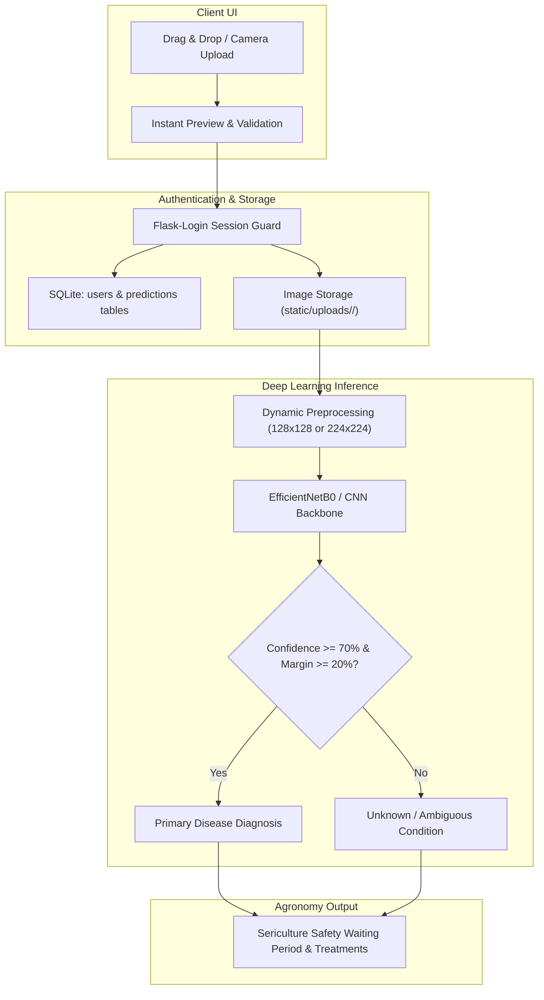

# 🍃 MulberryCare AI — Mulberry Leaf Disease Prediction & Intelligence Portal

[](https://www.python.org/)
[](https://tensorflow.org)
[](https://flask.palletsprojects.com/)
[](https://www.sqlite.org/)
[](https://github.com/sathishkumar1612/Mulberry-Leaf-Disease-Prediction)

An intelligent deep-learning and clinical pathology portal engineered for sericulture farmers, agronomists, and moriculture researchers. Accurately identifies mulberry leaf diseases (*Morus alba* / *Morus indica*), prevents devastating crop failure, safeguards silkworm (*Bombyx mori*) feed nutrition, and detects out-of-distribution or ambiguous foliar afflictions.

---

## 📌 Table of Contents
- [Core Features & System Upgrades](#-core-features--system-upgrades)
- [Supported Disease Classes](#-supported-disease-classes)
- [Architecture & Performance Engineering](#-architecture--performance-engineering)
- [Project Directory Structure](#-project-directory-structure)
- [Installation & Quickstart](#-installation--quickstart)
- [Running the Application](#-running-the-application)
- [Retraining the Model with EfficientNetB0](#-retraining-the-model-with-efficientnetb0)
- [Agronomic & Sericulture Safety Guidelines](#-agronomic--sericulture-safety-guidelines)

---

## 🚀 Core Features & System Upgrades

### 1. 🔐 User Authentication & Session Security
- **Secure Registration & Login**: Built with `Flask-Login` and `Werkzeug` secure PBKDF2 password hashing.
- **SQLite Database**: Self-initializing database (`users` and `predictions` tables) in `instance/mulberry_app.db`.
- **Pre-configured Demo Account**: Instant evaluator access with username `demo` and password `demo1234`.

### 2. 📋 Per-User Diagnostic History & Archival
- Automatically preserves uploaded leaf imagery in user-isolated directories (`static/uploads/<user_id>/`).
- Interactive History dashboard with filter tabs (*All*, *Healthy*, *Rust*, *Spot*, *Unknown*).
- Full diagnostic modal showing confidence breakdowns, thumbnail zooms, and treatment actions.

### 3. 🎨 Clean Light Professional Agricultural UI
- Modern, accessible dashboard themed in crisp whites and natural sericulture emerald accents (`#15803d`, `#16a34a`).
- Drag-and-drop image uploader with camera capture support and live preview.
- Real-time animated probability distribution bars for all 4 diagnostic classes.
- Print-ready diagnosis reporting for field records.

### 4. 🛡️ 4-Class Classification Engine & OOD Uncertainty Filter
- **Disease Free** 🌿 · **Potential Leaf Rust** ⚠️ · **Potential Leaf Spot** 🚨 · **Unknown / Unidentified Disease** ❓.
- Solves closed-set softmax misclassifications by routing low-confidence (< 70%) or narrow-margin (< 20%) predictions to the *Unknown Disease* category.

### 5. 🧠 State-of-the-Art Training Pipeline (`train_advanced_model.py`)
- **EfficientNetB0 Backbone** ($224 \times 224$ input) pre-trained on ImageNet.
- **Heavy Augmentation**: RandomFlip, RandomRotation(0.2), RandomZoom(0.2), RandomTranslation(0.15), RandomContrast(0.15).
- **Warmup Cosine Decay**: Linear learning rate warmup followed by smooth cosine annealing.
- **Automated Class Balancing**: Dynamically computes class weights to eliminate dataset skew.
- **Two-Phase Transfer Learning**: Initial frozen feature extraction followed by fine-tuning top backbone layers.

---

## 🌿 Supported Disease Classes

| Class | Pathogen / Condition | Typical Visual Symptoms | Severity |
| :--- | :--- | :--- | :---: |
| **Disease Free** | Healthy *Morus alba* | Uniform vibrant green leaf blade, intact venation | `healthy` |
| **Potential Leaf Rust** | *Cerotelium fici* | Fine brownish-orange powdery pustules (uredinia) on underside | `warning` |
| **Potential Leaf Spot** | *Pseudocercospora mori* | Dark brown necrotic spots with chlorotic yellow halos | `danger` |
| **Unknown / Ambiguous** | Novel pathogen / OOD | Overlapping spots, powdery mildew, mosaic virus, or blur | `unknown` |

---

## 📊 Architecture & Performance Engineering



---

## 📂 Project Directory Structure

```text
Mulberry-Leaf-Disease-Prediction/
├── app.py                                   # Production Flask app (Auth, History, Inference)
├── streamlit_app.py                         # Alternative interactive Streamlit UI
├── train_advanced_model.py                  # EfficientNetB0 two-phase training pipeline
├── requirements.txt                         # Production package dependencies
├── README.md                                # Comprehensive project documentation
├── INTEGRATION_GUIDE.md                     # Integration and deployment notes
├── mulberry_leaf_disease_Identification.keras # Pre-trained Keras model weights
├── instance/
│   └── mulberry_app.db                      # SQLite database (auto-created on startup)
├── static/
│   ├── css/
│   │   └── style.css                        # Clean light professional design system
│   └── uploads/                             # User image archives (auto-created)
└── templates/
    ├── base.html                            # Master layout, navigation & flash messages
    ├── login.html                           # Authentication sign-in with demo auto-fill
    ├── register.html                        # User account registration
    ├── dashboard.html                       # Main leaf scanner & live diagnosis report
    ├── history.html                         # Diagnostic history with filter & modal detail
    └── guide.html                           # Sericulture foliar pathology guide
```

---

## ⚙️ Installation & Quickstart

### 1. Clone the Repository
```bash
git clone https://github.com/sathishkumar1612/Mulberry-Leaf-Disease-Prediction.git
cd Mulberry-Leaf-Disease-Prediction
```

### 2. Set Up Virtual Environment
```bash
# Windows
python -m venv myenv
myenv\Scripts\activate

# Linux / macOS
python3 -m venv myenv
source myenv/bin/activate
```

### 3. Install Dependencies
```bash
pip install -r requirements.txt
```

---

## 🖥️ Running the Application

### Launch the Flask Web Application
```bash
python app.py
```
Open your web browser and visit: **`http://127.0.0.1:5000`**

- **Demo Login**: Use username `demo` and password `demo1234` (or click "Auto-fill Demo Credentials" on the login page).
- **Register**: Or create your own personalized account to keep a private diagnostic history.

---

## 🧠 Retraining the Model with EfficientNetB0

To train the high-accuracy EfficientNetB0 model on your mulberry leaf dataset:

```bash
python train_advanced_model.py \
  --train_dir path/to/dataset/train \
  --val_dir path/to/dataset/val \
  --output mulberry_leaf_disease_Identification_v2.keras \
  --warmup_epochs 10 \
  --finetune_epochs 15 \
  --batch_size 32
```

### Training Highlights:
- **Phase 1**: Trains the classification head with frozen EfficientNetB0 backbone using Warmup Cosine Decay (`base_lr=1e-3`).
- **Phase 2**: Unfreezes top backbone layers for subtle fine-tuning (`base_lr=1e-5`).
- **Class Weights**: Automatically balances rare disease instances against frequent ones.
- **Evaluation**: Outputs confusion matrix, per-class accuracy, and full precision/recall/F1 metrics.

---

## 💊 Agronomic & Sericulture Safety Guidelines

| Disease | Recommended Control | Silkworm Safety Window |
| :--- | :--- | :---: |
| **Healthy Foliage** | Balanced NPK (300:120:120 kg/ha/yr split) | Immediate feeding safe |
| **Leaf Rust** (*Cerotelium fici*) | Spray Mancozeb 0.2% (2g/L) or Copper Oxychloride 0.2% | **10–14 days withholding** |
| **Leaf Spot** (*Pseudocercospora mori*) | Spray Bavistin (Carbendazim 0.1%) or Chlorothalonil 0.2% | **10–12 days withholding** |
| **Unknown Pathogen** | Quarantine foliage; inspect for virus/powdery mildew | Do not feed until confirmed |

> [!WARNING]
> **Silkworm Toxicity Notice**: Feeding freshly sprayed leaves to *Bombyx mori* larvae causes acute flacherie and heavy mortality. Always observe the minimum 10–14 day withholding period after fungicide application.

---

*Authored for the [Mulberry-Leaf-Disease-Prediction](https://github.com/sathishkumar1612/Mulberry-Leaf-Disease-Prediction) repository.*
